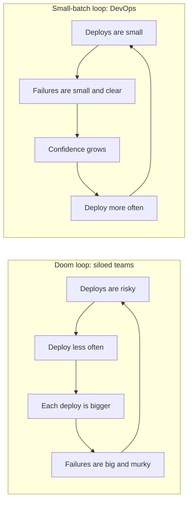
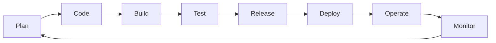
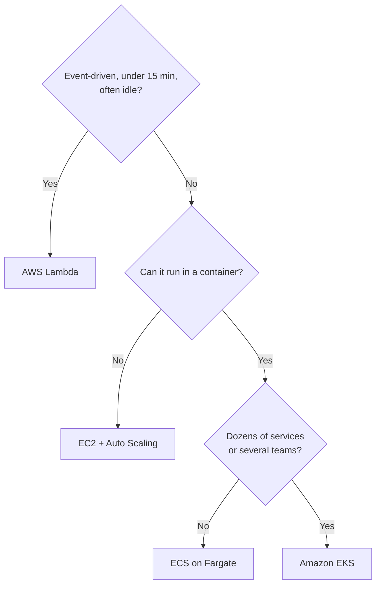
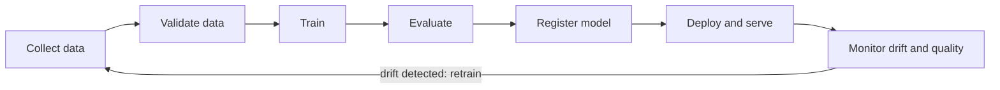

# Lesson 01 · The DevOps Big Picture: Cheat Sheet

> Write [`my-notes.md`](my-notes.md) first. Use this page to check and fill gaps afterwards.

**In one sentence:** DevOps is a way of working in which the people who build a service share responsibility for running it, and use automation and measurement to make changes small, frequent and safe.

---

## 1. Why DevOps exists: batch size is the lever

Developers are rewarded for change and Operations for stability. Separate them and you get a wall, plus this loop:

- Most traditional lead time is **waiting in queues** between teams, not working.
- DevOps is faster because it **removes queues and handoffs** and replaces manual checks with automated ones, not because people type faster.
- A failed small change has **one suspect** and an automatic rollback. A failed big batch has dozens of suspects.

## 2. The four DORA metrics

| Metric | Measures | Group |
|---|---|---|
| Deployment frequency | How often you deploy to production | Speed |
| Lead time for changes | Commit to running in production | Speed |
| Change failure rate | Share of deploys that cause a failure | Stability |
| Failed deployment recovery time | Time to restore service after a bad deploy (formerly MTTR) | Stability |

**Headline finding:** speed and stability are not a trade-off. The best teams are better at both, because small batches help both.

## 3. What DevOps is not

| Myth | Reality |
|---|---|
| A tool you install | Tools support it. Kubernetes plus a monthly release train isn't DevOps. |
| A separate team that deploys for everyone | That rebuilds the wall. A *platform team* building self-service tooling is different. |
| Devs doing ops work instead of features | The goal is to automate ops work away. |
| Move fast and break things | Frequent small deploys break things *less*. |

**CALMS:** **C**ulture (shared ownership, blameless reviews) · **A**utomation (anything done twice gets scripted) · **L**ean (small batches, no queues) · **M**easurement (decide with data) · **S**haring (open dashboards, runbooks, postmortems).

**Related job titles:** DevOps Engineer, Platform Engineer, Site Reliability Engineer (SRE), Cloud Engineer, MLOps Engineer. The skills largely overlap.

## 4. The delivery loop

| Stage | Purpose | Key idea | Tools | On AWS |
|---|---|---|---|---|
| Plan | Smallest change worth shipping | Thin slices; batch size starts here | Jira, GitHub Issues | none |
| Code | Change + tests + config in version control | If it isn't in Git, it doesn't exist | Git, GitHub | none |
| Build | One versioned, runnable artifact | Build once, deploy the same artifact everywhere | Docker, GitHub Actions | CodeBuild, ECR |
| Test | Prove it works before users find out | Test pyramid; feedback in ~10 min | pytest, Trivy | CodeBuild, Inspector |
| Release | Decide a version is ready for users | Separate deploy from release with feature flags | Git tags, LaunchDarkly | AppConfig |
| Deploy | Put it on infrastructure without dropping users | Boring, repeatable, reversible | Kubernetes, Helm, Argo CD, Terraform | ECS, EKS, CodeDeploy |
| Operate | Keep it running, scaled, patched, affordable | You build it, you run it | Autoscalers, PagerDuty | Auto Scaling, Systems Manager |
| Monitor | Know what users experience; feed planning | Alert on symptoms, not causes | Prometheus, Grafana, OpenTelemetry | CloudWatch, X-Ray |

**The Three Ways** (*The DevOps Handbook*): **Flow** (fast left to right) · **Feedback** (fast right to left) · **Continual learning**.

## 5. CI vs Continuous Delivery vs Continuous Deployment

| | CI | Continuous Delivery | Continuous Deployment |
|---|---|---|---|
| Build + test every merge | automatic | automatic | automatic |
| Deploy to staging + acceptance tests | manual | automatic | automatic |
| Deploy to production | manual | **one click, a person decides** | automatic |
| Use when | always (the minimum) | release timing is a business or legal decision | tests and monitoring beat human review |

Each level contains the one before it. When someone says "we do CD", ask which one.

## 6. Pets vs cattle

- **Pets:** named, hand-tended servers, repaired when sick. **Cattle:** numbered, identical servers built from code, replaced when sick.
- **Configuration drift:** hand-made changes make servers differ from each other and from any definition. Those changes are invisible: unreviewed, unrecorded, and deleted by the next rebuild.
- **Immutable infrastructure:** never change a running server by hand. Change the definition, build a new version, replace the old servers.
- **Infrastructure as Code:** every server, network and permission is defined in Git and can rebuild the environment from nothing.
- The same principle shows up in Docker (app package, L07), Terraform (cloud infrastructure, L12) and Kubernetes (running containers, L13).

## 7. The tool map

| Layer | Tool | Solves | You don't need it when |
|---|---|---|---|
| Application & ML | MLflow | Tracks training runs; model registry | One-off notebook work |
| Application & ML | SageMaker (AI) | Managed ML training, hosting and pipelines on AWS | You already run a mature K8s ML platform |
| Orchestration | Kubernetes | Runs, heals, scales containers across machines | One to a few services, small team |
| Orchestration | Amazon EKS | Managed K8s control plane on AWS | You haven't decided you need K8s |
| Orchestration | ECS / Fargate | Simpler AWS containers; Fargate removes servers | You need multi-cloud or the K8s ecosystem |
| Orchestration | Helm | Templates and packages K8s config | You're not on K8s |
| Packaging | Docker | App + dependencies in one portable image | Static site, small Lambda |
| OS | Linux | What everything runs on | Never optional |
| Cloud infra | EC2 | Virtual machines | App fits containers or Lambda |
| Cloud infra | VPC | Your private network in AWS | Never optional (start in the default VPC) |
| Cloud infra | S3 | Durable object storage, the home for ML data | You need a mounted filesystem or a database |
| Cloud infra | Lambda | Event-driven functions, pay per use, scale to zero | Jobs over 15 min, steady high load, GPUs |
| Rail: version control | Git | History, collaboration, rollback | Never optional |
| Rail: CI/CD | GitHub Actions | Automated pipelines on repo events | You're standardized on GitLab CI or Jenkins |
| Rail: CI/CD | Argo CD | GitOps: cluster syncs itself to Git | You're not on K8s |
| Rail: IaC | Terraform | Declare infrastructure, plan, apply | Throwaway experiments |
| Rail: IaC | Ansible | Configures software on servers over SSH | Container-first setups |
| Rail: observability | Prometheus + Grafana | Metrics, alerts, dashboards | Small AWS-only setups (start with CloudWatch) |
| Rail: observability | CloudWatch | AWS metrics, logs, alarms | Rarely skipped on AWS |
| Rail: security | IAM | Who can do what on which resource | Never optional |

**Common confusions:** Git ≠ GitHub · image (recipe) ≠ container (running instance) · Kubernetes runs images but doesn't build them · Fargate is a compute option for ECS *and* EKS, not an orchestrator · Terraform creates infrastructure, Ansible configures what runs inside it · S3 isn't a disk · default EC2 metrics don't include memory · prefer IAM roles over long-lived access keys.

## 8. Where should an app run on AWS?

| | Lambda | ECS on Fargate | EKS | EC2 |
|---|---|---|---|---|
| You manage | Code and settings | Image, task size, scaling rules | Workloads, add-ons, upgrades, maybe nodes | Everything from the OS up |
| You pay for | Requests + run time (ms) | vCPU and memory per second | Cluster fee per hour + compute | Instance per second |
| Idle cost | Zero | Tasks you keep running | Cluster fee + nodes | Full price while running |
| Watch out | 15-min limit, cold starts | AWS-specific | Steep curve, needs owners | Patching and scaling are yours |

**Blind spot:** Kubernetes is the most over-adopted tool on the list. Default to the simplest option that fits.

## 9. Where MLOps fits

Ordinary software has one thing that changes between releases: **code**. ML systems have three: **code, data and model**. A model can decay with zero code changes because live data drifts away from the training data.

MLOps adds: data and model versioning (DVC, MLflow, L21) · reproducible training pipelines (Kubeflow, SageMaker Pipelines, L23) · model serving (KServe, vLLM, SageMaker endpoints, L22) · monitoring of inputs and predictions (L23). LLMOps applies the same ideas to prompts, eval sets, retrieval indexes, token cost and latency.

## 10. Glossary

| Term | Meaning |
|---|---|
| Artifact | The versioned output of a build (a package or container image) that gets deployed |
| Batch size | How many changes go out together in one deploy |
| Lead time | Time from commit to running in production |
| Pipeline | The automated sequence of build, test and deploy steps |
| Environment | A full running copy of the system: dev, staging, production |
| Canary | Release to a small share of users first and compare error rates |
| Blue/green | Run old and new versions side by side and switch traffic over at once |
| Rollback | Return to the previous working version |
| Feature flag | A runtime switch that controls who sees new code, separating deploy from release |
| Configuration drift | Servers diverging from each other and from their definition through manual changes |
| Immutable infrastructure | Replace servers with new versions; never modify running ones |
| Idempotent | Running it twice gives the same result as running it once |
| Orchestration | Automatically placing, running, healing and scaling many containers |
| Observability | Understanding a system's internal state from its metrics, logs and traces |
| SLO | Service level objective: a target for reliability, such as 99.9% of requests succeeding |
| Data drift | Live input data shifting away from what the model was trained on |
